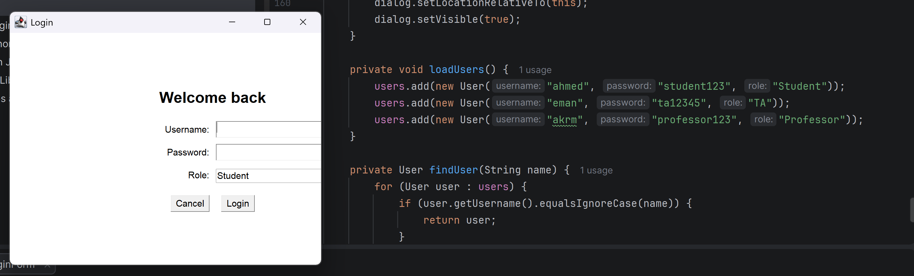
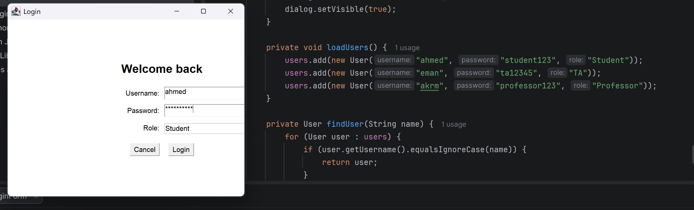
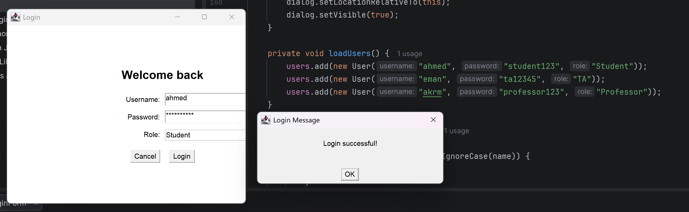
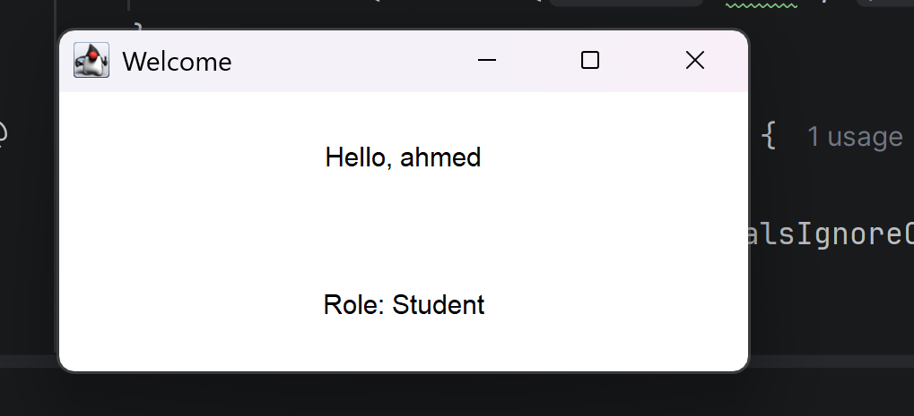
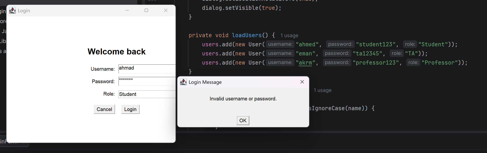
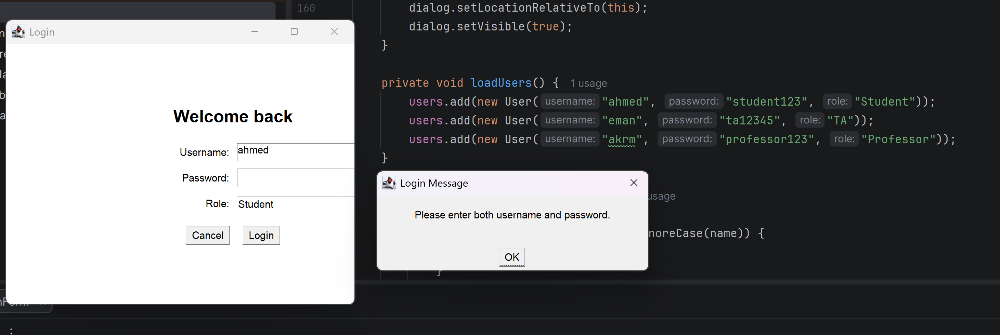
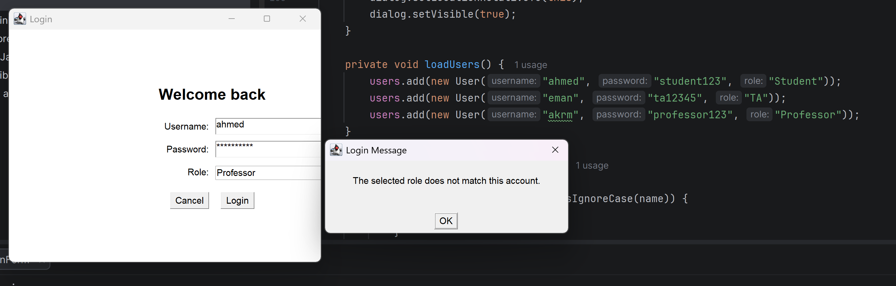
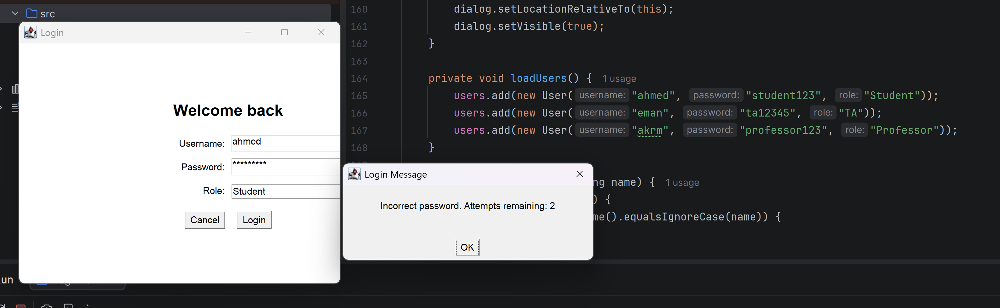
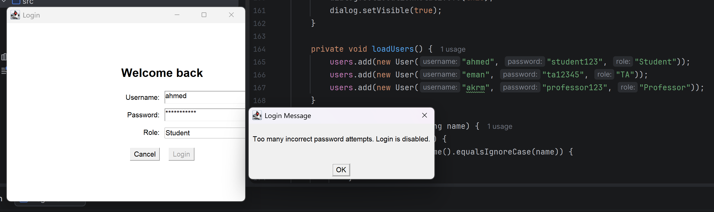

# Java AWT Login Form

A simple desktop login application built with **Java AWT**. It demonstrates hard-coded user accounts, input validation, role verification, and a lockout after three incorrect password attempts.

## Features

- Login form with username, password, and role selection.
- Hard-coded test accounts for Student, TA, and Professor roles.
- Validation for empty username or password fields.
- Validation for unknown usernames or incorrect passwords.
- Verification that the selected role matches the account's assigned role.
- Failed-password attempt counter; the Login button is disabled after three incorrect passwords.
- Welcome window displaying the signed-in user's username and role.
- Cancel button to close the login window.

## Technologies

- Java
- Java AWT (`Frame`, `Panel`, `Label`, `TextField`, `Choice`, `Button`, and event listeners)

## Test Accounts

The following accounts are hard-coded in `loadUsers()` for this educational task.

| Role | Username | Password |
|---|---|---|
| Student | `ahmed` | `student123` |
| TA | `eman` | `ta12345` |
| Professor | `akrm` | `professor123` |

> These credentials are for demonstration only. Do not use hard-coded plaintext passwords in production applications.

## Screenshots

### 1. Login form



### 2. Login form with credentials entered



### 3. Successful login message



### 4. Welcome page



### 5. Invalid username or password



### 6. Empty fields validation



### 7. Role mismatch validation



### 8. Incorrect password attempt counter



### 9. Login disabled after three incorrect password attempts



## How to Run

### Requirements

- JDK 8 or newer
- A desktop environment that supports Java AWT

Open a terminal in the directory containing `LoginFormTask.java`, then run:

```bash
javac LoginFormTask.java
java LoginFormTask
```

## Project Structure

```text
Java-AWT-Login-Form/
├── LoginFormTask.java
├── README.md
└── screenshots/
    ├── 01-login-form.png
    ├── 02-login-form-filled.png
    ├── 03-login-success-message.png
    ├── 04-welcome-page.png
    ├── 05-invalid-username-or-password.png
    ├── 06-empty-fields-validation.png
    ├── 07-role-mismatch-validation.png
    ├── 08-incorrect-password-attempts.png
    └── 09-login-disabled-after-three-failures.png
```

## Notes

This is an educational example of GUI programming and basic login validation. Users are hard-coded and passwords are stored as plain text, so this implementation is not intended for production use.
